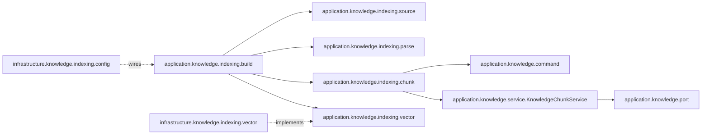

# 工程结构与公共能力

项目使用单个 Maven 工程，通过 Java 包划分模块。技术基线为 Java 21、Spring Boot 4.1.1、Spring AI 2.0.1、MyBatis-Plus 3.5.17；MinIO 与 OSS SDK 分别为 8.5.17 和 3.18.2。

用户、文件与知识库基础是当前业务模块。学习入口见 [用户实现](./modules/user.md)、[文件实现](./modules/file.md) 和 [知识库实现](./modules/knowledge.md)。知识库只提供内部 Java 服务，公开 HTTP 合同仍见 [API 文档](./reference/api/README.md)。

返回 [文档导航](./README.md)。

## 四层结构

根包为 `com.item.aisummary`，按“层 → 业务 → 职责”组织：

```text
web ───────────────→ application ─────→ domain
                          ↑               ↑
                    infrastructure ───────┘
```

| 层 | 当前职责 | 边界 |
| --- | --- | --- |
| `web` | Controller、请求校验、响应字段映射、HTTP 异常处理 | 不直接操作数据库或 SDK，不承载业务规则 |
| `application` | 用户、文件与知识库用例、请求身份、跨模块引用及外部能力 port | 通过接口调用仓储、密码摘要或对象存储，不依赖其实现 |
| `domain` | 用户数据与文本规则、文件归属、知识库记录与片段位置规则 | 不依赖 Spring、MyBatis 或供应商 SDK |
| `infrastructure` | 构造器装配、MyBatis、BCrypt、模拟身份、存储 SDK 与知识库 Spring AI 向量适配 | 实现应用接口，处理外部协议、生命周期与异常转换；当前没有生产解析器/分块器 |

`port` 是应用定义的外部能力接口。例：用户服务只认识 `PasswordHasher`，BCrypt 的具体编码器留在基础设施；文件服务只认识 `UploadSource`，MultipartFile 留在 Web 层。

领域层保持轻量，实际需要时才创建实体、值对象或领域服务。当前不拆分 Maven 模块，也不预先引入无关基础设施。

## 包结构与命名

同一业务的不同职责使用独立子包。请求、应用输入、领域数据和数据库实体各有明确归属：

| 层 | 当前子包 | 说明 |
| --- | --- | --- |
| `web.user` | `controller`、`request`、`response` | HTTP 入口、字段校验与六字段响应 |
| `web.file` | `controller`、`response`、`upload` | HTTP 入口、七字段响应与 multipart 来源适配 |
| `web.health`、`web.error` | 保持单一职责 | 健康检查与公共异常转换 |
| `application.user` | `service`、`command`、`result`、`port`、`reference` | 用户用例、输入输出、外部能力及用户引用合同 |
| `application.file` | `service`、`content`、`policy`、`result`、`port` | 文件用例、内容读取合同、约束和外部能力 |
| `application.knowledge` | 基础 `service`（KnowledgeBase/Document/Revision/Chunk 四服务）、`command/SaveKnowledgeChunkCommand`、`port`（四仓储）、`indexing/{build,source,parse,chunk,vector}` | 基础用例与持久化合同独立于 RAG 专用构建流程；indexing 按能力聚合上下文/结果/阶段/异常、原字节源读取、解析合同、分块合同与组写入、向量合同，不在组内再分 service/port/model |
| `domain.user` | `model`、`exception` | 用户数据和未找到异常 |
| `domain.file` | `model`、`rule`、`exception` | 文件数据、文本规则与业务异常 |
| `domain.knowledge` | `model`、`value`、`enums`、`rule`、`exception` | 四表记录、标题及 `SourceLocation` 值对象、状态、输入规则与异常；位置约束由 `KnowledgeRules.requireLocation` 提供 |
| `infrastructure.user / file / knowledge` | 基础 `config`、`persistence`，以及已有 `reference / storage`；知识库另有 `indexing/config`、`indexing/vector` | 基础装配和持久化保持原位；RAG 条件装配/Properties 与 Spring AI 向量适配归入 indexing |
| `infrastructure.auth` | `config`、`web` | 模拟身份配置与请求集成 |
| `infrastructure.persistence.typehandler`、`infrastructure.time` | 公共基础能力 | UTC 类型转换与共享时钟 |

知识库 RAG 合同与流程位于 `application.knowledge.indexing`，按能力组织，而非基础服务分层：

```text
indexing/
├── build/   # KnowledgeIndexBuildService、KnowledgeBuildLifecycleService、KnowledgeProcessingRouter、构建上下文/结果/阶段/异常
├── source/  # KnowledgeSourceReader、PreparedSource、FileFormat、KnowledgeSourceException
├── parse/   # KnowledgeDocumentParser、ParsedDocument、ContentBlock、ContentBlockType
├── chunk/   # KnowledgeChunker、ChunkingMode/Options、ChunkDraft、ChunkGroupDraft、KnowledgeChunkGroupWriter
└── vector/  # KnowledgeVectorIndex、KnowledgeVectorEntry
```

这些类型是处理合同、编排服务或外部能力接口，不是数据库实体或具体解析/分块算法。构建服务通过 `KnowledgeProcessingRouter` 选择 parser 与 chunker；组写入器把构建组转成基础 `SaveKnowledgeChunkCommand`，并调用基础 `KnowledgeChunkService.saveBatch`。基础服务不反向依赖 indexing。`KnowledgeChunkService` 与四个基础仓储 port 继续位于原有 `service`、`port` 包。

知识库基础设施的 `config/KnowledgeConfiguration` 和全部 `persistence` 保持不动；RAG 专用 `KnowledgeRagConfiguration`、`KnowledgeRagProperties` 位于 `infrastructure.knowledge.indexing.config`，Spring AI 向量适配位于 `infrastructure.knowledge.indexing.vector`。`SourceLocation` 留在 `domain.knowledge.value`，其偏移/页码规则由 `KnowledgeRules.requireLocation` 校验。



向量适配与组 writer 分别实现向量和持久化调用边界；RAG 配置负责条件装配，不改变基础仓储或表结构。

三个业务的 MyBatis 文件统一按职责分类。以知识库为例：

```text
infrastructure/knowledge/
├── config/            # 基础 KnowledgeConfiguration
├── indexing/
│   ├── config/        # RAG 条件装配、KnowledgeRagProperties
│   └── vector/        # 已实现的 Spring AI 向量适配（没有生产 Reader/Splitter）
└── persistence/
    ├── entity/        # 四表数据库实体
    ├── mapper/        # 四个 Mapper，封装 SQL 入口
    ├── repository/    # 四个应用仓储接口的 MyBatis 实现
    └── typehandler/
        └── HeadingPathTypeHandler.java
```

只为已有职责创建子包，不提前补齐空目录。`application.auth`、用户 `reference`、`web.error`、BCrypt 和已有 SDK 适配包可以保持集中。跨职责类型使用显式导入；HTTP 生命周期测试归对应 `controller` 包，仓储集成测试归 `persistence.repository`，其余测试跟随主要被测类。

文件下游集中依赖 `application.file.content` 中的 `FileContentService`、`ProcessableFileAsset` 和 `FileContentResource`；用户引用集中在 `application.user.reference`。这些合同仍要求原有身份、归属和流关闭规则，包结构不引入新权限或业务能力。

## 请求身份与用户引用

[LoginUserContext](../src/main/java/com/item/aisummary/infrastructure/auth/web/LoginUserContext.java) 通过请求属性提供 `CurrentUser`，身份只在当前 HTTP 请求内有效。

默认模拟拦截器对 `/api/**` 注入配置身份，跳过 OPTIONS，并在请求结束后清理。它不解析 Authorization、不创建 Session，也不会在用户表插入模拟账户。

用户 CRUD 没有身份或权限校验。文件入口先校验身份；缺失返回 401，归属或可处理状态不符统一返回 404。内部内容读取同样要求调用者显式传入用户 ID，后台任务不能依赖请求上下文。

`UserReferenceService` 是跨模块用户存在性合同，不承担登录或权限判断。模拟模式只接受配置 ID；关闭模拟时，数据库实现查询未删除用户，不按账户 status 过滤。文件服务当前不调用用户引用查询，文件所有者来自入口身份。

## 公共错误与请求标识

[GlobalExceptionHandler](../src/main/java/com/item/aisummary/web/error/GlobalExceptionHandler.java) 将错误转换为 ProblemDetail，即包含状态、说明和问题类型的统一 HTTP 错误对象。

响应显式包含 `type`、`title`、`status`、`detail`、`instance` 和 `code`；可取得请求标识时附带 `requestId`，字段校验错误只返回 `field/message`。未知异常固定显示“服务器内部错误”，不回显 SDK、SQL 或用户输入。

不支持的 Content-Type 返回 `415 / UNSUPPORTED_MEDIA_TYPE`，保留框架协议头。文件业务校验、容器大小限制与 SDK 失败分别映射为 400、413 和 502。完整状态码与格式见 [错误响应](./reference/api/common.md#错误响应)。

[RequestIdFilter](../src/main/java/com/item/aisummary/infrastructure/web/RequestIdFilter.java) 接受符合 `[A-Za-z0-9][A-Za-z0-9._-]{0,63}` 的 `X-Request-Id`，其他情况生成 UUID，并在响应头返回该值。请求标识只用于关联请求与错误，不提供身份。

## 持久化与时间

领域数据不带 MyBatis 注解；表映射实体只在基础设施中使用。生产表位于 [schema.sql](../deploy/mysql/schema.sql)，手动执行；没有物理外键或级联清理。

用户与文件的未删除条件为 `deleted_at IS NULL`，与业务 `status` 独立。删除时间使用数据库 `CURRENT_TIMESTAMP(6)`；用户和知识库用例通过注入共享的 [ClockConfiguration](../src/main/java/com/item/aisummary/infrastructure/time/ClockConfiguration.java) 获取 UTC 时钟，并保留微秒精度。文件用例直接使用 `Instant.now()`。知识库四表没有删除时间字段，当前服务不提供删除。

知识文档登记通过 `FileContentService.requireOwnedProcessable` 检查源文件元数据及归属，不读取正文。关联存在性由应用服务检查，三组联合唯一约束由数据库兜底。版本号采用 MAX + 1，竞争冲突明确失败。

片段批次与版本生命周期分别使用短事务。`KnowledgeChunkService.saveBatch` 是基础服务的事务入口，使用 Spring 事务与 READ_COMMITTED 隔离级别，锁定版本后插入并更新实际总数；失败整批回滚，同版本并发追加串行执行。`KnowledgeChunkGroupWriter.saveGroups` 在构建侧为传入的整批组分配连续序号、角色和父序号，转换为 `SaveKnowledgeChunkCommand` 后一次调用通过 Spring 注入的 `KnowledgeChunkService` 代理；writer 不声明事务、不自行创建事务服务。`KnowledgeBuildLifecycleService` 创建构建时锁文档防止重复 building，发布时在同一事务中更新 ready、活动指针和旧版本 superseded。

`KnowledgeIndexBuildService.build` 拒绝外层事务；文件读取、策略执行、Embedding、Qdrant 和旧向量清理均在数据库事务外执行。组写入期间仅基础 `KnowledgeChunkService.saveBatch` 的数据库事务开启。数据库与 Qdrant 没有共同回滚，失败或旧向量清理也不能替代后续检索的活动版本过滤。

MySQL 的 `DATETIME(6)` 不保存时区。[UtcInstantTypeHandler](../src/main/java/com/item/aisummary/infrastructure/persistence/typehandler/UtcInstantTypeHandler.java) 显式按 UTC 在数据库时间与 `Instant` 之间转换。连接与会话也必须使用 UTC，历史时间不能未经确认直接解释为 UTC。

## 外部能力与阶段边界

模型和存储默认关闭；普通测试使用 H2、Mock 或内存存储替身。健康接口不探测这些外部服务。

Spring AI 依赖用于未来模型能力与当前向量适配。当前已实现的 RAG 固定骨架包含专用 indexing 合同、格式/模式路由、预读原始字节并核对大小与 SHA-256、组式 chunk writer、向量批次和版本生命周期；没有生产文档解析器或分块器，也没有生产 `TextReader`、`MarkdownDocumentReader` 或 `TokenTextSplitter` 流程。`PreparedSource` 保存同一份已验证原始字节，但不执行 UTF-8 解码；未来文本解析器负责该校验。

RAG 默认关闭。开启时需有实际注册的解析与 FLAT 分块策略、OpenAI Embedding 及 Qdrant 适配器，否则启动失败；配置变量本身不能启用真实 txt/md 处理。策略替身测试可覆盖固定编排、本地持久化与向量边界，但不等价于真实解析、切分或外部调用验收。`build(actor,document)` 默认选 FLAT，内部第三参数可选 PARENT_CHILD，不新增模式配置项。数据库批次以整组为单位，`RAG_BATCH_SIZE` 不拆组；向量仅写 RETRIEVAL 且使用精确批次上限，`RAG_MAX_NUM_CHUNKS` 统计所有角色。

当前没有真实登录、退出、角色权限、账户启停、客户端直传、跨系统自动补偿、完整并发治理、PDF/DOCX/OCR 解析、异步任务、检索或问答。知识库基础持久化和父子字段存储、固定构建编排及版本发布已实现；未来能力仍按明确需求加入。

开发约定与同步要求见 [AGENTS.md](../AGENTS.md)，构建和验证边界见 [测试说明](./guides/testing.md)。
