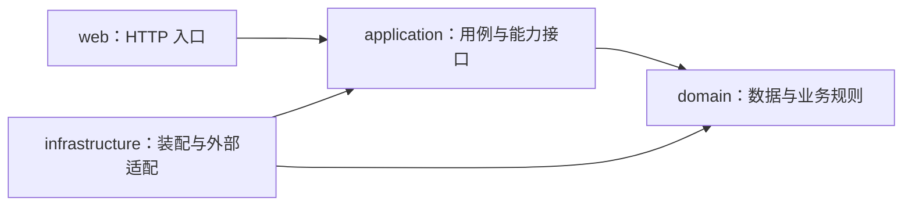

# 工程结构与公共能力

项目使用单个 Maven 工程，根包为 `com.item.aisummary`，通过 Java 包划分用户、文件和知识库模块。技术版本以 [pom.xml](../../pom.xml) 为准，开发规则见 [AGENTS.md](../../AGENTS.md)。返回 [文档导航](../README.md)。

## 四层结构

以下箭头表示代码依赖方向：

| 层 | 职责与边界 |
| --- | --- |
| `web` | Controller、参数校验、响应与异常转换；不直接调用数据库、模型或存储 SDK |
| `application` | 用例编排及外部能力接口；通过接口调用仓储、密码摘要、文件内容、解析、切分和向量能力 |
| `domain` | 领域数据、值对象与业务规则；不依赖 Web、Spring AI、数据库客户端或厂商 SDK |
| `infrastructure` | Spring 装配、MyBatis、BCrypt、存储 SDK、本地/云端解析与向量适配；实现应用层接口 |

`port` 表达应用所需的外部能力。例如用户服务只认识 `PasswordHasher`，BCrypt 实现在基础设施；文件服务通过 `UploadSource` 读取上传内容，`MultipartFile` 适配留在 Web 层。

## 包结构与命名

普通业务按“层 → 业务 → 职责”组织，例如 `web.user.controller`、`application.file.service`、`domain.knowledge.value`。请求、用例输入、领域数据和数据库实体各自归位，不集中到通用 DTO 包。MyBatis 适配按 `persistence.entity / mapper / repository / typehandler` 分包。

知识库基础服务位于 `application.knowledge.service`，保存命令和仓储接口分别位于 `command`、`port`。RAG 专用能力聚合在 `application.knowledge.indexing`：

| 能力包 | 职责 |
| --- | --- |
| `build` | 构建编排、策略路由与版本生命周期 |
| `source` | 原文件字节准备、大小和摘要校验 |
| `parse` | 格式无关的解析输入输出合同 |
| `chunk` | 分块合同与构建组保存适配 |
| `vector` | 向量写入与按版本清理合同 |

`indexing` 各组不再增加 service/port/model 子层。组 writer 将父子分组转换为基础 `SaveKnowledgeChunkCommand`，调用基础 `KnowledgeChunkService`；基础服务不反向依赖 indexing。

对应基础设施位于 `infrastructure.knowledge.indexing/{config,parse,chunk,vector}`。知识库基础装配和四表持久化保留在 `infrastructure.knowledge/{config,persistence}`。测试跟随主要被测类的生产包结构；仅为已有职责创建包。

## 请求身份与用户引用

[LoginUserContext](../../src/main/java/com/item/aisummary/infrastructure/auth/web/LoginUserContext.java) 从请求属性取得当前身份。默认模拟身份仅作用于 `/api/**` 非 OPTIONS 请求，结束时清理；不解析凭据、不创建 Session 或数据库用户。

用户 CRUD 不执行身份或权限校验；文件入口校验身份及所有者。后台内容处理必须显式传用户 ID，并由调用方关闭返回流。跨模块文件合同集中在 `application.file.content`。

`application.user.reference.UserReferenceService` 仅回答用户是否存在。模拟模式只接受配置 ID；关闭模拟后查询未删除用户，不按账户状态过滤。该能力不承担认证或权限判断，文件服务不通过它校验所有者。详细规则见 [用户模块](../modules/user.md) 和 [文件模块](../modules/file.md)。

## 公共错误与请求标识

[GlobalExceptionHandler](../../src/main/java/com/item/aisummary/web/error/GlobalExceptionHandler.java) 统一生成 ProblemDetail。[RequestIdFilter](../../src/main/java/com/item/aisummary/infrastructure/web/RequestIdFilter.java) 接受合法的 `X-Request-Id` 或生成 UUID，并通过响应头返回。

请求标识仅用于关联请求。HTTP 响应字段和错误码集中维护在 [HTTP API](./api.md#错误响应)，不在架构文档重复列出。

## 持久化与时间

领域对象不带 MyBatis 注解；数据库实体只用于基础设施。正式表结构见 [schema.sql](../../deploy/mysql/schema.sql)，由使用者手动执行，不自动升级旧表；表间采用逻辑关联，无物理外键或级联清理。

用户和文件的未删除条件为 `deleted_at IS NULL`，独立于业务 `status`；删除时间由数据库生成。MySQL 连接与会话采用 UTC，[UtcInstantTypeHandler](../../src/main/java/com/item/aisummary/infrastructure/persistence/typehandler/UtcInstantTypeHandler.java) 将 `DATETIME(6)` 显式按 UTC 映射为 `Instant`。用户和知识库用例注入共享 Clock，文件用例使用 `Instant.now()`，创建和修改时间截断到微秒。

知识库片段保存和版本生命周期分别使用短事务；`KnowledgeIndexBuildService.build` 拒绝外层事务。文件读取、解析、切分及向量调用在数据库事务外执行，发布时原子更新版本状态与文档活动指针。MySQL 和向量库没有共同事务，未来检索须按 MySQL 活动版本过滤；详细行为见 [知识库模块](../modules/knowledge.md#生命周期与失败边界)。

## 外部能力与阶段边界

运行配置与开关见 [配置说明](./configuration.md)。模型、对象存储和 RAG 默认关闭；RAG 开启时要求生产解析器、FLAT 分块器、OpenAI Embedding 与 Qdrant，缺少后端或配套 Bean 拒绝启动。TXT/Markdown/DOCX 本地解析不访问外网；PDF 云解析需另行显式开启 DocMind，处理时会上传文件并可能产生费用。

当前没有真实登录、知识库 HTTP、权限、异步任务、检索或问答。普通测试使用 H2、真实本地解析/切分与外部替身；外部服务和真实云调用尚未验收。测试命令见 [项目 README](../../README.md#验证)。
